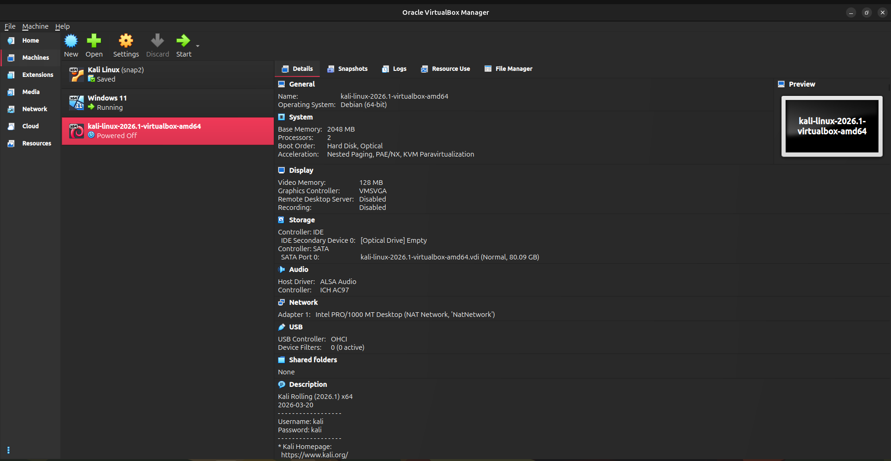
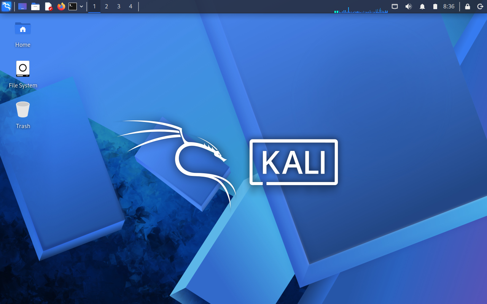
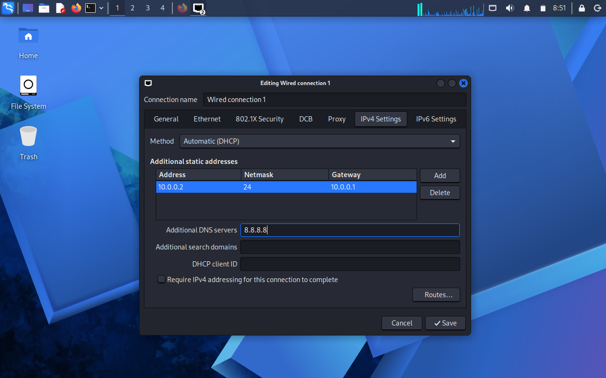
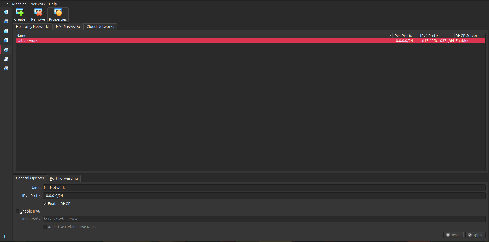

<div align="center">

# 🔐 Cybersecurity Lab Environment Setup

**Building an Isolated Virtual Laboratory for Cybersecurity Learning, Penetration Testing, and Ethical Hacking**

<p>


</p>

</div>

---

# 📌 Project Overview

This project documents the creation and configuration of a **virtual cybersecurity laboratory** using **Oracle VirtualBox** and **Kali Linux**. The environment provides a secure and isolated platform for learning cybersecurity concepts, experimenting with penetration testing tools, and performing security-related practical exercises without affecting production systems.

The laboratory has been configured using a **NAT Network**, allowing virtual machines to communicate securely while maintaining Internet access. The setup serves as the foundation for future cybersecurity projects involving vulnerable machines, web application testing, digital forensics, network security, and ethical hacking.

---

# 🎯 Project Objectives

The objectives of this project were to:

- Install and configure Oracle VirtualBox.
- Import and configure Kali Linux.
- Create a private NAT Network.
- Configure networking for the Kali virtual machine.
- Verify network connectivity.
- Configure shared folders between the host and guest operating systems.
- Install essential cybersecurity tools.
- Create a clean recovery snapshot.
- Document the entire setup process for future reference.

---

# 🛡️ Purpose of the Laboratory

The cybersecurity laboratory provides a safe environment for learning and practicing cybersecurity techniques.

The laboratory supports activities such as:

- Network reconnaissance
- Host discovery
- Port scanning
- Packet capture and analysis
- Vulnerability assessment
- Linux administration
- Security tool experimentation
- Ethical hacking practice

---

# 🏗️ Lab Architecture

<p align="center">

</p>

The architecture consists of an Ubuntu host machine running Oracle VirtualBox, which hosts a Kali Linux virtual machine connected through a dedicated NAT Network. This design provides a controlled environment that can later be expanded by adding additional target virtual machines.

---

# ⚙️ Laboratory Configuration

| Component | Configuration |
|-----------|---------------|
| **Host Operating System** | Ubuntu |
| **Host RAM** | 16 GB |
| **Processor** | Intel Core i5 |
| **Hypervisor** | Oracle VirtualBox 7.2 |
| **Guest Operating System** | Kali Linux 2026.1 |
| **Installation Method** | Pre-built VirtualBox Image |
| **Virtual CPUs** | 2 |
| **Allocated RAM** | 6.7 GB |
| **Username** | kali |
| **Network Mode** | NAT Network |
| **IP Address** | 10.0.2.15 |
| **Shared Folder** | `/media/sf_VM_Shared` |

---

# 🪜 Laboratory Setup Procedure

## Step 1 — Install Oracle VirtualBox

Oracle VirtualBox version **7.2** was installed on the Ubuntu host computer to provide the virtualization environment required for running Kali Linux.

---

## Step 2 — Unzip and Import Kali Linux

The official pre-built Kali Linux VirtualBox image was downloaded, unzipped using 7-Zip and imported into VirtualBox.

The virtual machine was configured with:

```text
Operating System : Kali Linux 2026.1
RAM              : 6.7 GB
Processors       : 2 CPUs
Username         : kali
```

<p align="center">

</p>

---

## Step 3 — Configure the NAT Network

A dedicated NAT Network was created to allow communication between virtual machines while maintaining Internet connectivity.

Configuration:

```text
Network Name : NatNetwork

IPv4 Network : 10.0.0.0/24

DHCP         : Enabled

IPv6         : Disabled
```

<p align="center">

</p>

Using a NAT Network makes it possible to add additional virtual machines in future projects while keeping all systems within the same isolated laboratory environment.

---

## Step 4 — Configure Kali Linux Networking

The network adapter was configured inside VirtualBox using the following settings:

```text
Adapter 1

Attached To : NAT Network

Network     : NatNetwork

Adapter Type: Intel PRO/1000 MT Desktop
```

The network configuration inside Kali Linux was verified using:

```bash
ip a
```

Example output:

```text
IPv4 Address : 10.0.2.15
```

<p align="center">

</p>

---

## Step 5 — Configure Shared Folder

A shared folder was configured between the Ubuntu host and Kali Linux virtual machine.

Mount location:

```bash
/media/sf_VM_Shared
```

The shared folder simplifies transferring:

- Project documentation
- Scripts
- Security tools
- Assignment files
- Reports

---

## Step 6 — Install Cybersecurity Tools

The system packages were updated before installing commonly used cybersecurity tools.

Example commands:

```bash
sudo apt update

sudo apt upgrade

sudo apt install nmap wireshark net-tools curl git
```

These tools will be used throughout future cybersecurity laboratory exercises.

---

## Step 7 — Create a Recovery Snapshot

Once the installation and configuration were complete, a VirtualBox snapshot was created.

Example snapshot name:

```text
Clean Kali Lab Setup
```

Creating a clean snapshot allows the virtual machine to be restored quickly whenever future experiments modify or damage the system.

---

# 🔍 Laboratory Verification

The following commands were used to verify that the laboratory was functioning correctly.

| Verification | Command | Expected Result |
|--------------|---------|-----------------|
| Check IP Address | `ip a` | Correct IP Address displayed |
| Verify Network Interfaces | `ip link` | Interface is UP |
| Test Internet Connectivity | `ping 8.8.8.8` | Successful replies |
| Test DNS Resolution | `nslookup google.com` | Domain resolves successfully |
| Verify NetworkManager | `nmcli device` | Connected interface displayed |
| Verify Nmap Installation | `nmap --version` | Installed version displayed |
| Verify Shared Folder | `ls /media/sf_VM_Shared` | Folder contents displayed |

---

# 🐞 Challenges Encountered

## 1. Network Connectivity Issues

During the initial configuration, Kali Linux experienced network connectivity problems while connected to the NAT Network.

Troubleshooting included:

```bash
nmcli device

nmcli connection show

sudo systemctl restart NetworkManager
```

The VirtualBox network settings were reviewed and corrected until the guest operating system successfully obtained network connectivity.

---

## 2. Shared Folder Configuration

The shared folder was initially inaccessible from Kali Linux.

The issue was resolved by adding the current user to the VirtualBox shared folder group.

```bash
sudo usermod -aG vboxsf kali
```

The virtual machine was restarted after applying the changes.

---

## 3. Display Resolution

The display resolution inside Kali Linux did not automatically adjust to the VirtualBox window.

Installing the VirtualBox Guest Additions and restarting the virtual machine resolved the issue.

---

# 📚 Skills and Knowledge Gained

This project provided practical experience in:

- Virtual machine deployment
- Oracle VirtualBox administration
- Linux installation and configuration
- Network configuration
- NAT Network implementation
- Shared folder management
- Basic Linux networking commands
- Troubleshooting connectivity issues
- Cybersecurity laboratory documentation

---

# 🚀 Future Improvements

The current laboratory provides a foundation for future cybersecurity projects.

Planned additions include:

- Metasploitable 2
- OWASP Broken Web Applications
- Windows target virtual machine
- DVWA (Damn Vulnerable Web Application)
- OWASP Juice Shop
- Wireshark traffic analysis exercises
- Nmap scanning exercises
- Vulnerability assessment projects

---

# 🔐 Security and Ethical Use

This cybersecurity laboratory is intended solely for educational purposes.

All penetration testing, scanning, and security assessments must only be conducted against systems owned by the user or systems where explicit authorization has been granted.

Unauthorized testing of external systems is illegal and unethical.

---

# 🛠️ Technologies Used

- Oracle VirtualBox 7.2
- Kali Linux 2026.1
- Ubuntu
- Linux Terminal
- NetworkManager
- Nmap
- Wireshark
- Git
- GitHub

---

# 📖 References

- Oracle VirtualBox Documentation
- Kali Linux Documentation
- Linux Manual Pages (`man`)
- NetworkManager Documentation
- GitHub Documentation

---

# 👨‍💻 Author

**Stephen Oduor**

**Course:** Cybersecurity

**Project:** Cybersecurity Lab Setup

**Repository:** `network_walk-B085`

---

<div align="center">


This repository serves as the foundation for future cybersecurity laboratory assignments and practical exercises.

</div>
